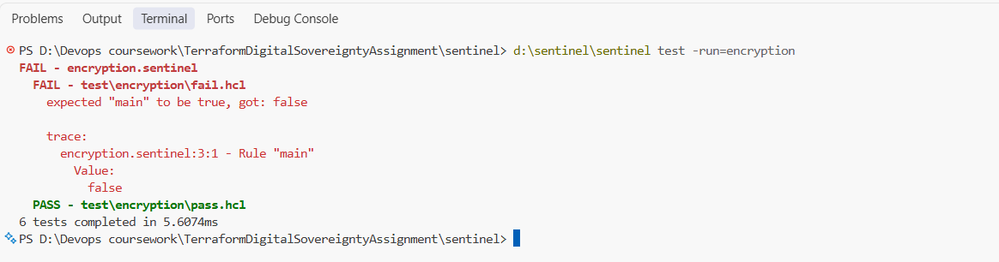
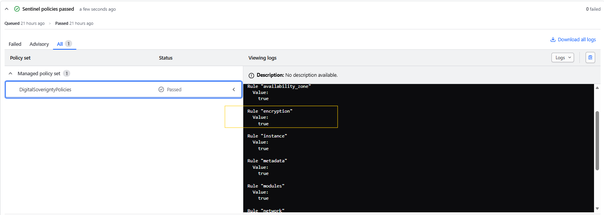

# Terraform Digital Sovereignty Assignment - Encryption.Sentinel

**Student:** James Smith  
**Module:** DevOps and Cloud Automation  
**Institution:** Atlantic Technological University (ATU)


**Require encryption of EC2 root storage volumes.**

Ensure that all EC2 storage volumes are encrypted

**Policy**
```hcl
main = rule {
   all tfplan.resource_changes as _, rc {
    rc.type != "aws_instance" or (
      length(rc.change.after.root_block_device) > 0 and
      rc.change.after.root_block_device[0].encrypted) 
      }
}
```
**Mocks**

Pass.hcl
```hcl
mock "tfplan/v2" {
  data = {
    resource_changes = {
      web = {
        type = "aws_instance"

        change = {
          after = {
            root_block_device = [
              {
                encrypted = true
              }
            ]
          }
        }
      }
    }
  }
}

test {
  rules = {
    main = true
  }
}
```

fail.hcl
```hcl
mock "tfplan/v2" {
  data = {
    resource_changes = {
      web = {
        type = "aws_instance"

        change = {
          after = {
            root_block_device = [
              {
                encrypted = false
              }
            ]
          }
        }
      }
    }
  }
}

test {
  rules = {
    main = true
  }
}
```

The encryption.sentinel policy evaluates a resource of type "aws_instance" and and checks whether the root_block_device[0] is true
The mocks pass/fail.hcl are setup to either set the encryption to true/false
the test expects a true result, and will pass or fail depending on the value of the mock

**Result**

*Command line Sentinel*



*HCP Online Portal*

```tf
  resource "aws_instance" "web" {
  ami               = var.ami_id
  instance_type     = var.instance_type
  availability_zone = var.availability_zone
  vpc_security_group_ids = [
    aws_security_group.web.id
  ]

  root_block_device {
    encrypted = true
  }
  ```
  

  ```tf
  resource "aws_instance" "web" {
  ami               = var.ami_id
  instance_type     = var.instance_type
  availability_zone = var.availability_zone
  vpc_security_group_ids = [
    aws_security_group.web.id
  ]

  root_block_device {
    encrypted = false
  }
  ```
  