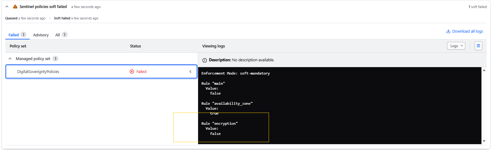

# Terraform Digital Sovereignty Assignment - Encryption.Sentinel

**Student:** James Smith  
**Student Number:** L00205519
**Module:**  IaC for DevOps Pipelines

**Policy**

[Encryption Sentinel Policy](../../encryption.sentinel)

**Mocks**

[Mock for Pass](pass.hcl)

[Mock for Fail](fail.hcl)


The encryption.sentinel policy evaluates a resource of type "aws_instance" (EC2) and and checks whether the root_block_device[0] is true
The mocks pass/fail.hcl are setup to either set the encryption to true/false
the test expects a true result, and will pass or fail depending on the value of the mock

**Result**

*Command line Sentinel*


*HCP Online Portal*

```tf
  resource "aws_instance" "web" {
  ami               = var.ami_id
  instance_type     = var.instance_type
  availability_zone = var.availability_zone
  vpc_security_group_ids = [
    aws_security_group.web.id
  ]

  root_block_device {
    encrypted = true
  }
  ```
  

  ```tf
  resource "aws_instance" "web" {
  ami               = var.ami_id
  instance_type     = var.instance_type
  availability_zone = var.availability_zone
  vpc_security_group_ids = [
    aws_security_group.web.id
  ]

  root_block_device {
    encrypted = false
  }
  ```
  