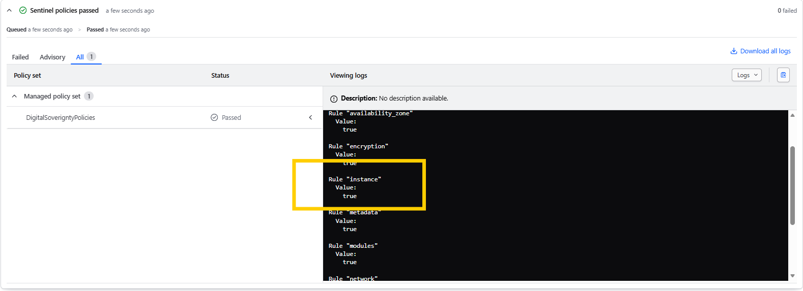
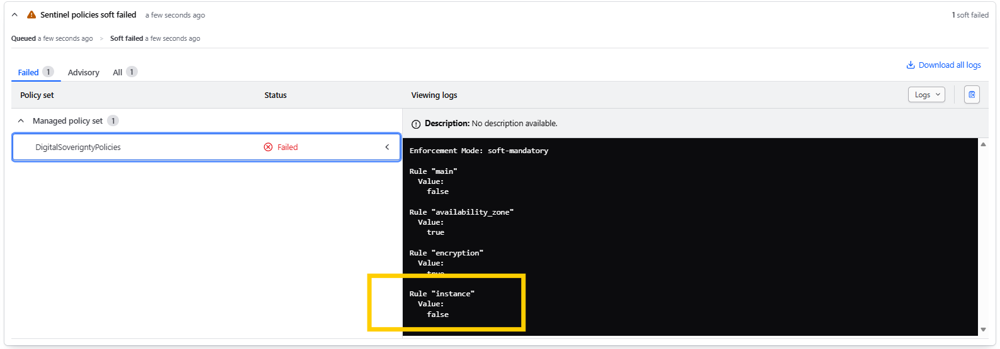

# Terraform Digital Sovereignty Assignment - Instance.Sentinel

**Student:** James Smith  
**Student Number:** L00205519
**Module:**  IaC for DevOps Pipelines


**Policy**

[Instance Sentinel Policy](../../instance.sentinel)

**Mocks**

[Mock for Pass](pass.hcl)

[Mock for Fail](fail.hcl)


The instance.sentinel policy evaluates a resource of type "aws_instance" (EC2)  and checks whether the instance type is in the list of Allowed Instances, ("t2.micro","t3.micro",)

**Result**

*Command line Sentinel*


*HCP Online Portal*

```tf
  resource "aws_instance" "web" {
  ami               = var.ami_id
  instance_type     = "t2.micro"
  availability_zone = var.availability_zone
  vpc_security_group_ids = [
    aws_security_group.web.id
  ]
  ```
  

  ```tf
  resource "aws_instance" "web" {
  ami               = var.ami_id
  instance_type     = "t3.large"
  availability_zone = var.availability_zone
  vpc_security_group_ids = [
    aws_security_group.web.id
  ]
  ```
  