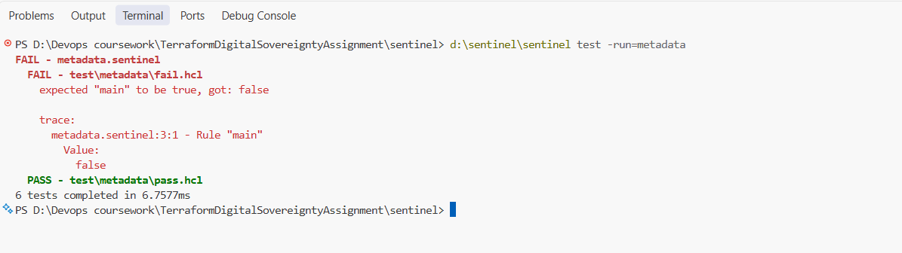
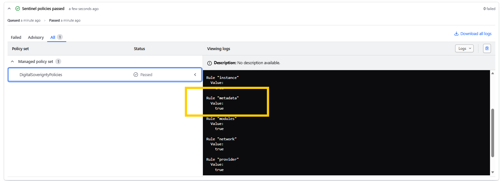
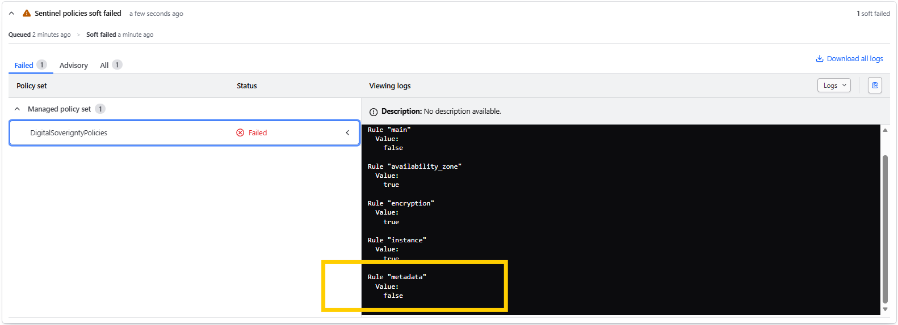

# Terraform Digital Sovereignty Assignment - Metadata.Sentinel

**Student:** James Smith  
**Module:** DevOps and Cloud Automation  
**Institution:** Atlantic Technological University (ATU)


**Policy**

[Instance Sentinel Policy](../../Metadata.sentinel)

**Mocks**

[Mock for Pass](pass.hcl)

[Mock for Fail](fail.hcl)

This policy enforces IMDSv2 (Instance Metadata Service Version 2) on all EC2 instances.

**Result**

*Command line Sentinel*



*HCP Online Portal*

```tf
  resource "aws_instance" "web" {
    ami               = var.ami_id
    instance_type     = var.instance_type
    availability_zone = var.availability_zone
    vpc_security_group_ids = [
      aws_security_group.web.id
    ]

    root_block_device {
      encrypted = true
    }

    metadata_options {
      http_endpoint = "enabled"
      http_tokens   = "required"
    }
  ```
  

  ```tf
  resource "aws_instance" "web" {
    ami               = var.ami_id
    instance_type     = var.instance_type
    availability_zone = var.availability_zone
    vpc_security_group_ids = [
      aws_security_group.web.id
    ]

    root_block_device {
      encrypted = true
    }

    metadata_options {
      http_endpoint = "enabled"
      http_tokens   = "optional"
    }
  ```
  