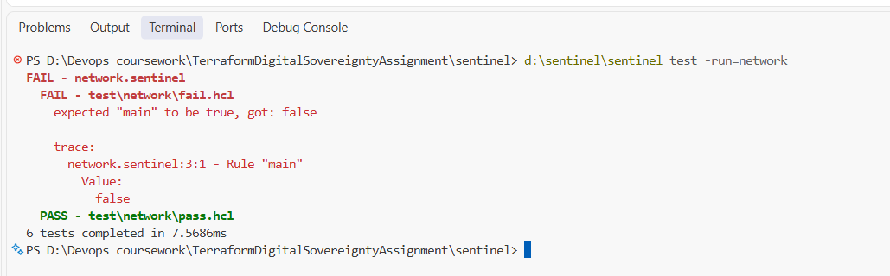
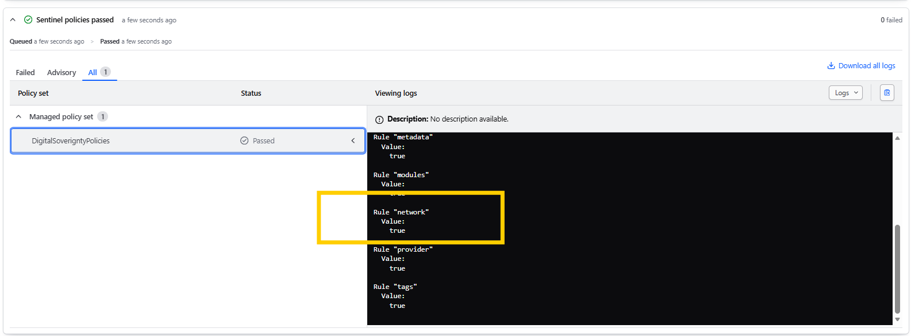
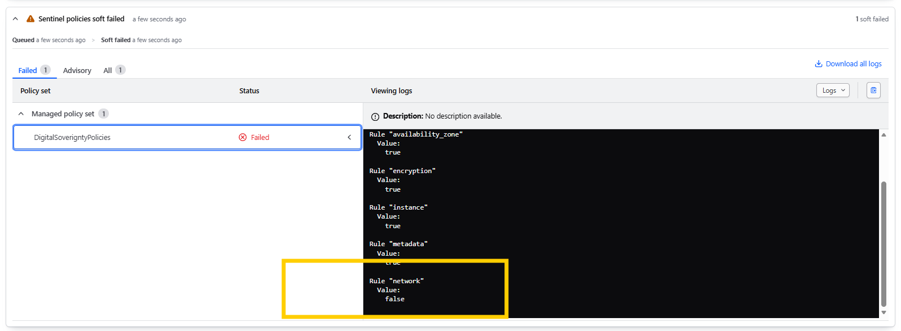

# Terraform Digital Sovereignty Assignment - Network.Sentinel

**Student:** James Smith  
**Student Number:** L00205519
**Module:**  IaC for DevOps Pipelines


**Policy**

[Network Sentinel Policy](../../Network.sentinel)

**Mocks**

[Mock for Pass](pass.hcl)

[Mock for Fail](fail.hcl)

This policy enforces a network security rule that prevents SSH access (port 22) from being open to the entire internet.
Every security group rule is checked. If a rule allows SSH (port 22) from anywhere on the internet (0.0.0.0/0), the policy fails.

**Result**

*Command line Sentinel*



*HCP Online Portal*

```tf
resource "aws_security_group_rule" "ssh" {
  type              = "ingress"
  security_group_id = aws_security_group.web.id

  from_port   = 22
  to_port     = 22
  protocol    = "tcp"
  cidr_blocks = ["10.0.0.0/8"]
}
  ```
  

  ```tf
resource "aws_security_group_rule" "ssh" {
  type              = "ingress"
  security_group_id = aws_security_group.web.id

  from_port   = 22
  to_port     = 22
  protocol    = "tcp"
  cidr_blocks = ["0.0.0.0/0"]
}
  ```
  
