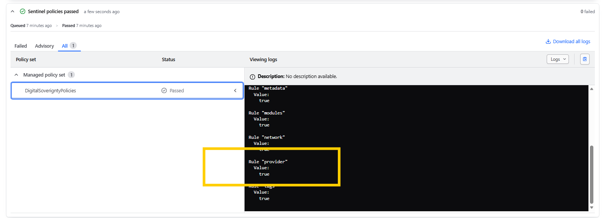
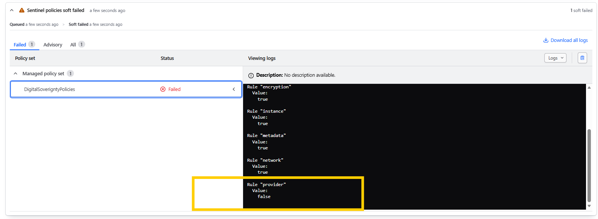

# Terraform Digital Sovereignty Assignment - sovereignty.Sentinel

**Student:** James Smith  
**Module:** DevOps and Cloud Automation  
**Institution:** Atlantic Technological University (ATU)


**Policy**
```tf
provider = rule {
  tfconfig.providers.aws.full_name is
    "registry.terraform.io/hashicorp/aws" and
  tfconfig.providers.aws.version_constraint matches "^~>"
}
 ```
[Provider Sentinel Policy](../../../hcp-research-files/hcp-managed-policy.sentinel)

**Mocks**
*NOTE: No Command line Mocks are available as this policy can only be run through HCP Portal because it requires "tfconfig/v2". this import is not available for Command line

This policy is checking that the Terraform configuration uses the official HashiCorp AWS provider and that the provider version is controlled using a pessimistic version constraint (~>) to pin to a specific version.

**Result**

*HCP Online Portal*

```tf
terraform {
  required_version = ">= 1.7.0"

  required_providers {
    aws = {
      source  = "hashicorp/aws"
      version = "~> 5.0"
    }
  }
}

  ```
  

  ```tf
terraform {
  required_version = ">= 1.7.0"

  required_providers {
    aws = {
      source  = "hashicorp/aws"
      version = ">= 5.0"
    }
  }
}

  ```
  