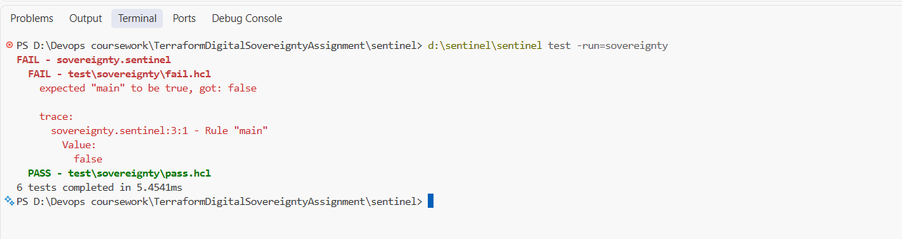
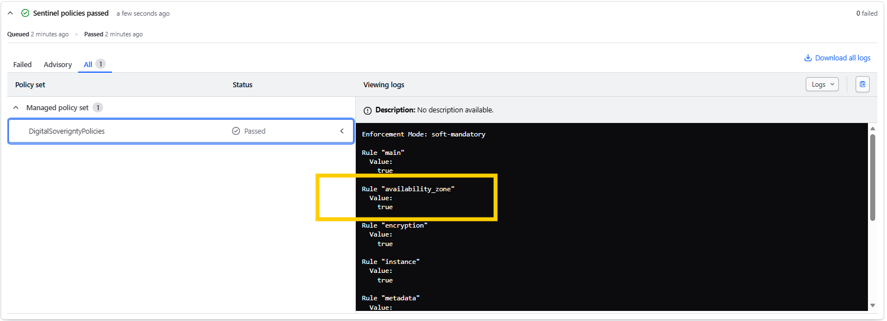
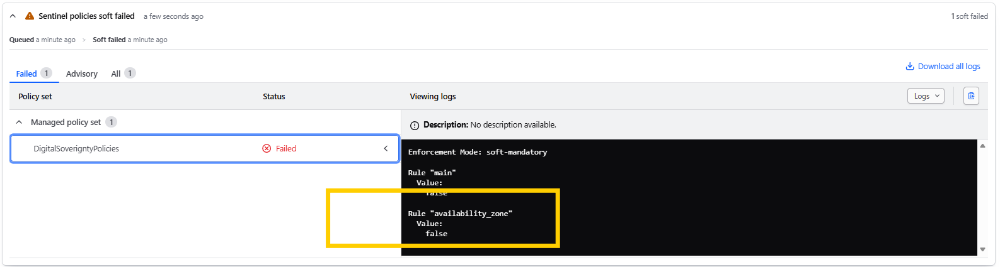

# Terraform Digital Sovereignty Assignment - sovereignty.Sentinel

**Student:** James Smith  
**Module:** DevOps and Cloud Automation  
**Institution:** Atlantic Technological University (ATU)


**Policy**

[Sovereignty Sentinel Policy](../../sovereignty.sentinel)

**Mocks**

[Mock for Pass](pass.hcl)

[Mock for Fail](fail.hcl)

This policy enforces a digital sovereignty requirement by restricting EC2 instances to specific European AWS Availability Zones.
Every EC2 instance must be deployed in an Availability Zone belonging to either Ireland (eu-west-1), London (eu-west-2), or Frankfurt (eu-central-1).

**Result**

*Command line Sentinel*



*HCP Online Portal*

```tf
resource "aws_instance" "web" {
  ami               = var.ami_id
  instance_type     = var.instance_type
  availability_zone = "eu-west-1a"
  vpc_security_group_ids = [
    aws_security_group.web.id
  ]

  ```
  

  ```tf
resource "aws_instance" "web" {
  ami               = var.ami_id
  instance_type     = var.instance_type
  availability_zone = "us-west-1a"
  vpc_security_group_ids = [
    aws_security_group.web.id
  ]

  ```
  