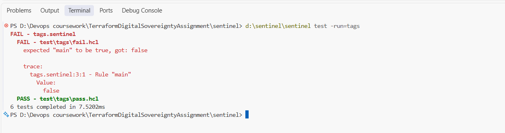
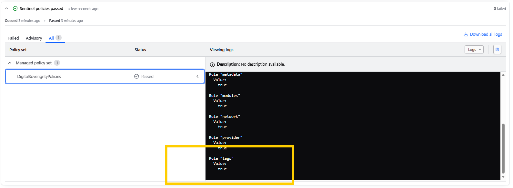
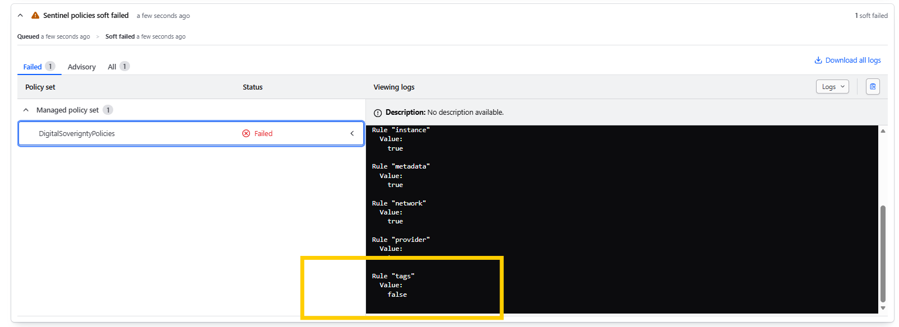

# Terraform Digital Sovereignty Assignment - tags.Sentinel

**Student:** James Smith  
**Student Number:** L00205519
**Module:**  IaC for DevOps Pipelines


**Policy**

[Tags Sentinel Policy](../../tags.sentinel)

**Mocks**

[Mock for Pass](pass.hcl)

[Mock for Fail](fail.hcl)

This policy enforces mandatory tagging on key AWS resources.
Every EC2 instance, S3 bucket, and Security Group must contain the tags Environment, Owner, and AssignmentName.

**Result**

*Command line Sentinel*



*HCP Online Portal*

```tf
resource "aws_instance" "web" {
  ami               = var.ami_id
  instance_type     = var.instance_type
  availability_zone = var.availability_zone
  vpc_security_group_ids = [
    aws_security_group.web.id
  ]

  root_block_device {
    encrypted = true
  }

  metadata_options {
    http_endpoint = "enabled"
    http_tokens   = "required"
  }

  tags = {
    Name       = "DigitalSovereigntyAssignment"
    Environment = "Prod"
    Owner = "James"
    AssignmentName = "Assessment"
  }
}
  ```
  

  ```tf
resource "aws_instance" "web" {
  ami               = var.ami_id
  instance_type     = var.instance_type
  availability_zone = var.availability_zone
  vpc_security_group_ids = [
    aws_security_group.web.id
  ]

  root_block_device {
    encrypted = true
  }

  metadata_options {
    http_endpoint = "enabled"
    http_tokens   = "required"
  }

  tags = {
    Name           = "DigitalSovereigntyAssignment"
    Environment    = ""
    Owner          = ""
    AssignmentName = ""
  }
}

  ```
  